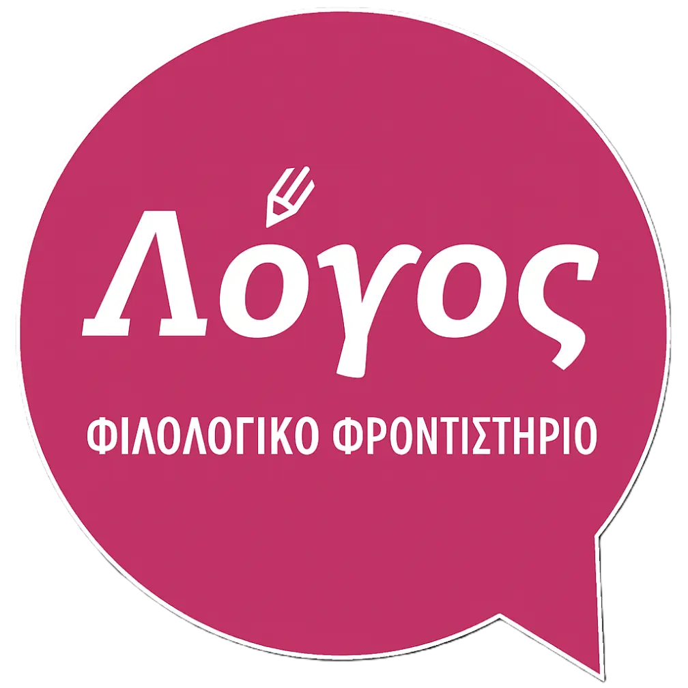

# Φιλολογικό Φροντιστήριο Λόγος - Ιστοσελίδα

  

  <strong>Ιστοσελίδα για το Φιλολογικό Φροντιστήριο Λόγος στη Δράμα.  
Ο ιστότοπος έχει σχεδιαστεί για να παρέχει πληροφορίες για το φροντιστήριο, τους καθηγητές, τις υπηρεσίες, καθώς και άμεση πρόσβαση σε εκπαιδευτικό υλικό.</strong> 

<h1 align="center">Η σελίδα μεταφέρθηκε!</h1>

  <strong>Η ανάπτυξη και η φιλοξενία της σελίδας μεταφέρθηκαν στο Codeberg.</strong> 
  Αυτό το αποθετήριο στο GitHub δεν ενημερώνεται πλέον. Λειτουργεί μόνο ως ανακατεύθυνση στο Codeberg.

<h3 align="center">
  <a href="https://frontistirio.codeberg.page/logos/">Επισκεφθείτε την Επίσημη Ιστοσελίδα</a>
</h3>

<h3 align="center">
  <a href="https://codeberg.org/frontistirio/logos">Επισκεφθείτε το Αποθετήριο στο Codeberg</a>
</h3>

<i>Διαχείρηση Ιστοσελίδας: Φιλολογικό Φροντιστήριο Λόγος, [Konstantinos2106](https://codeberg.org/Konstantinos2106)</i>
